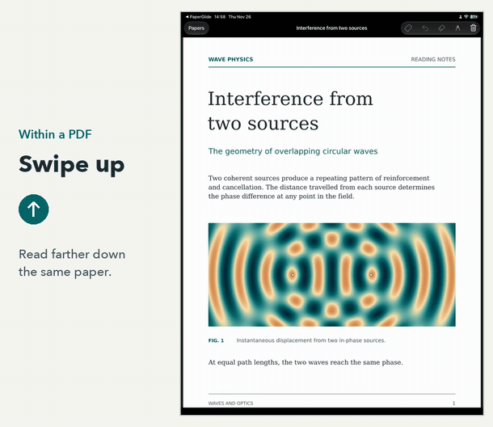
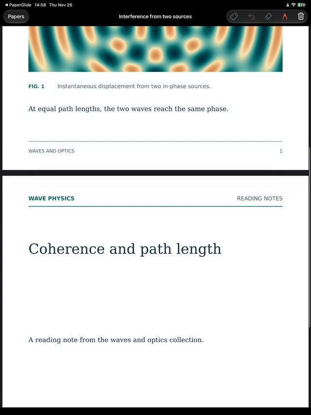
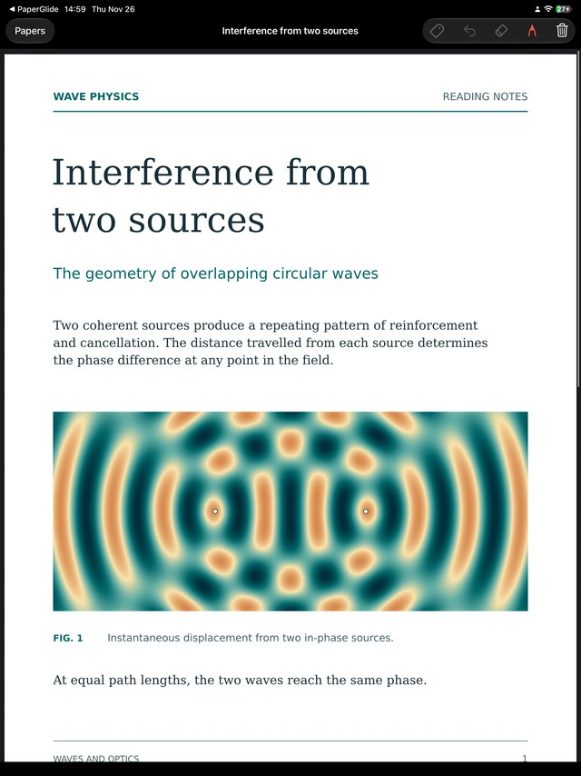
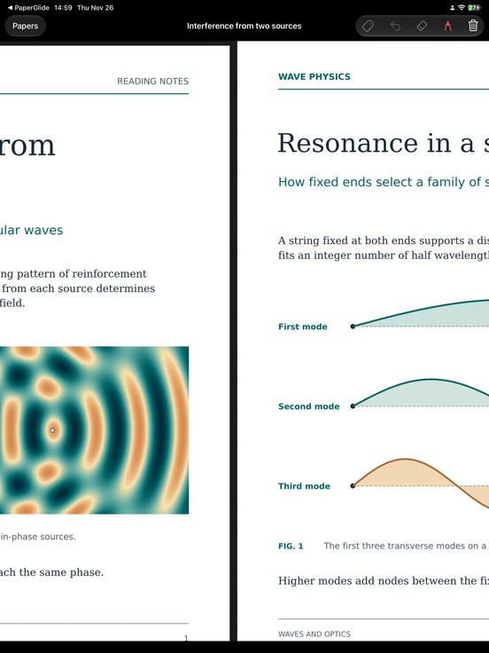

# PaperGlide for iPad

<p align="center">
  
</p>

Open a PDF, scroll vertically to read and swipe horizontally to the next or previous paper. A red tag button stays in the reader toolbar.

## Reading gestures

Swipe **up** to read farther down the PDF or **down** to revisit an earlier passage. Swipe **left** to open the next paper in your library list or **right** to go back.



[Download the iPad recording (MP4)](https://raw.githubusercontent.com/wangleiphy/PaperGlide/main/docs/gestures/reading-gestures.mp4)

<details>
<summary>See the gestures as still screenshots</summary>

| Swipe up ↑ | Swipe down ↓ | Swipe sideways ← → |
| --- | --- | --- |
|  |  |  |

</details>

## Install on your iPad

You’ll need a Mac with Xcode, an iPad running iPadOS 17 or later, a USB cable, and an Apple Account. A free Apple Account works for a personal install. Its signing profile lasts seven days. To renew it, reconnect the iPad and run the project again with the same account and bundle identifier. [Apple’s Personal Team guide](https://developer.apple.com/help/account/basics/about-your-developer-account)

1. **Get the project on your Mac.** On this GitHub page, choose **Code → Download ZIP**, unzip it, and open `PaperGlide.xcodeproj` in Xcode.
2. **Set up signing.** In **Xcode → Settings → Apple Accounts**, sign in. Select the blue **PaperGlide** project in the navigator, then **Targets → PaperGlide → Signing & Capabilities**. Enable **Automatically manage signing** and choose your team. If the bundle identifier is already registered to another team, enter a unique one such as `com.yourname.PaperGlide`, replacing `yourname` with your own identifier.
3. **Select your iPad.** Connect it to the Mac, unlock it, and tap **Trust** if prompted. In Xcode’s toolbar, choose the **PaperGlide** scheme and your iPad as the run destination. If Xcode requests Developer Mode, turn it on under **Settings → Privacy & Security → Developer Mode** on the iPad, then restart and confirm.
4. **Install and open the app.** Press **⌘R** in Xcode. When PaperGlide opens on the iPad, tap **Choose Folder** and select the iCloud Drive folder containing your PDFs. After installation, you can disconnect the cable and launch PaperGlide from the Home Screen. [Apple’s device setup guide](https://developer.apple.com/documentation/xcode/running-your-app-on-simulated-or-physical-devices)

## Use PaperGlide with Paper Recommender

Use PaperGlide on the iPad to mark papers you want more of. Paper Recommender runs on the Mac and uses those **Red** Finder tags as examples when ranking other papers. The two apps share a folder of PDFs through iCloud Drive. [Paper Recommender setup and options](https://github.com/wangleiphy/paper_recommender/#installation)

1. **Choose one folder on both devices.** The recommender defaults to **iCloud Drive → Downloads**. To follow the example below, create **iCloud Drive → Papers** instead, put a few PDFs in it, and select **Papers** with PaperGlide’s **Choose Folder** button.
2. **Mark a favorite on the iPad.** Open a paper and tap the tag icon until it turns red. Once iCloud syncs, check that the same PDF shows **Red** in Finder on the Mac. That is the signal the recommender reads.
3. **Run the recommender on the Mac.** Follow its installation instructions, then run either example from the `paper_recommender` checkout with its Python environment active.

   ```bash
   PAPERS="$HOME/Library/Mobile Documents/com~apple~CloudDocs/Papers"

   # Rank PDFs already in Papers and leave them in place.
   python scripts/recommend.py local --directory "$PAPERS" --refs tagged --no-move-duplicates

   # Find recent arXiv matches and download the recommended PDFs into Papers.
   python scripts/recommend.py arxiv --directory "$PAPERS" --refs tagged
   ```

4. **Read the results on the iPad.** The recommender marks its picks **Gray** in Finder. For a local pick, search PaperGlide for the filename printed by the command. For new arXiv downloads, pull down to refresh the library after iCloud syncs. The default creation-date sort puts new files near the top. Tag any new favorites **Red** to guide the next run.

## Read and tag

- Tap **Choose Folder** and select your shared papers folder in iCloud Drive. PaperGlide remembers that folder. For a nested collection, choose the subfolder you want to read.
- Type any part of a filename into **Search by filename**. Matching ignores capitalization. Papers appear newest creation date first by default. PaperGlide remembers any order you choose afterward. Use the **up/down arrows** in the library toolbar to sort by filename, creation date, or modification date. Either date can be sorted newest or oldest first.
- Tap a filename. Scroll up or down to read. Swipe left for the next paper, or right for the previous one. The swipe order follows the visible library list, including its current sort order, filename search, and red-tag filter.
- Pinch to zoom. While zoomed in, drag across the middle to pan a figure. Start a horizontal swipe within about a finger’s width of the left or right edge to change papers.
- Tap the outline tag to mark the current PDF. It turns red. Tap again to remove it. In the library, tap the tag button to show your red-tagged papers. A tagging change takes effect immediately. An open reading sequence keeps its order until you return to the library.
- Swipe left on a paper in the library and tap **Delete**, or tap the trash button in the reader. Confirm the filename to delete the PDF from its folder. Deleting from a shared folder affects everyone with access. After deleting in the reader, you return to the library.
- Return to a paper to resume at its saved page, position and zoom. Pull down in the library to refresh after someone adds or renames PDFs.

## Mark a PDF with Apple Pencil

Touch an open PDF with Apple Pencil and start writing. PaperGlide saves completed strokes, erasures, and undos directly to the PDF after a short pause. You can keep writing while it saves. Use one finger to scroll or swipe between papers, and pinch to zoom.

- Tap the **pencil** to return to writing with the current width. Touch and hold the pencil to choose Fine, Medium, or Thick. **Draw with finger** is available in the same menu. While finger drawing is on, use two fingers to scroll. Turn finger drawing off to swipe between papers.
- Tap the **eraser** and sweep across a stroke to remove it. Tap it again to write. The curved arrow undoes the last ink edit during your visit to that paper.
- If the original PDF changed elsewhere or its folder refuses the write, PaperGlide keeps a marked copy under **Files → On My iPad → PaperGlide → Recovered Markups** and shows its name. Subsequent edits during that visit go to the recovery copy.

## Storage and iCloud

PaperGlide opens your chosen folder through the iPad folder picker. It prepares temporary local snapshots of the current PDF and its immediate neighbors. A cloud-only neighbor can still show a loading screen until its first download finishes. In Files, **Keep Downloaded** can help before a flight or a session with poor connectivity.

PaperGlide writes the Red tag to Finder metadata on the PDF. Pull down to refresh tags changed elsewhere. Earlier in-app red tags transfer when you open their folder with write access. Reading positions stay on this iPad and are keyed by folder and filename.

## Continue development

The current version is PaperGlide 1.2 build 10. Open the Xcode project, select the **PaperGlide** scheme and an iPad simulator, and press **⌘R**. The app uses UIKit and PDFKit and has no third-party dependencies. Build 10 was compiled with Xcode 27.2.

| File | Responsibility |
| --- | --- |
| `PaperGlide/Library.swift` | Folder access, file metadata, Finder tags, sort preferences, and reading positions |
| `PaperGlide/LibraryController.swift` | Library list, filename search, and sort and filter controls |
| `PaperGlide/ReaderController.swift` | Switching papers, neighboring document loading, and markup controls |
| `PaperGlide/PaperPane.swift` | PDF display, zoom, and position restoration |
| `PaperGlide/Ink.swift` | Pencil input, stroke erasing, and saving PDF annotations |
| `PaperGlideUITests/ReaderTests.swift` | End-to-end reader and markup tests |

To finish checking cross-device tag sync, apply a red tag to a sample in iCloud Drive on an iPad and confirm that it appears in Finder on a separate Mac after syncing. Local tag writes on the iPad and macOS tag recognition were checked separately.

## Run the UI tests

Select an iPad simulator in Xcode and press **⌘U**. The test generates sample PDFs in the test app’s own Documents directory and exercises reading gestures, tag persistence, sorting, filename search, undo, and reopening automatically saved ink.
